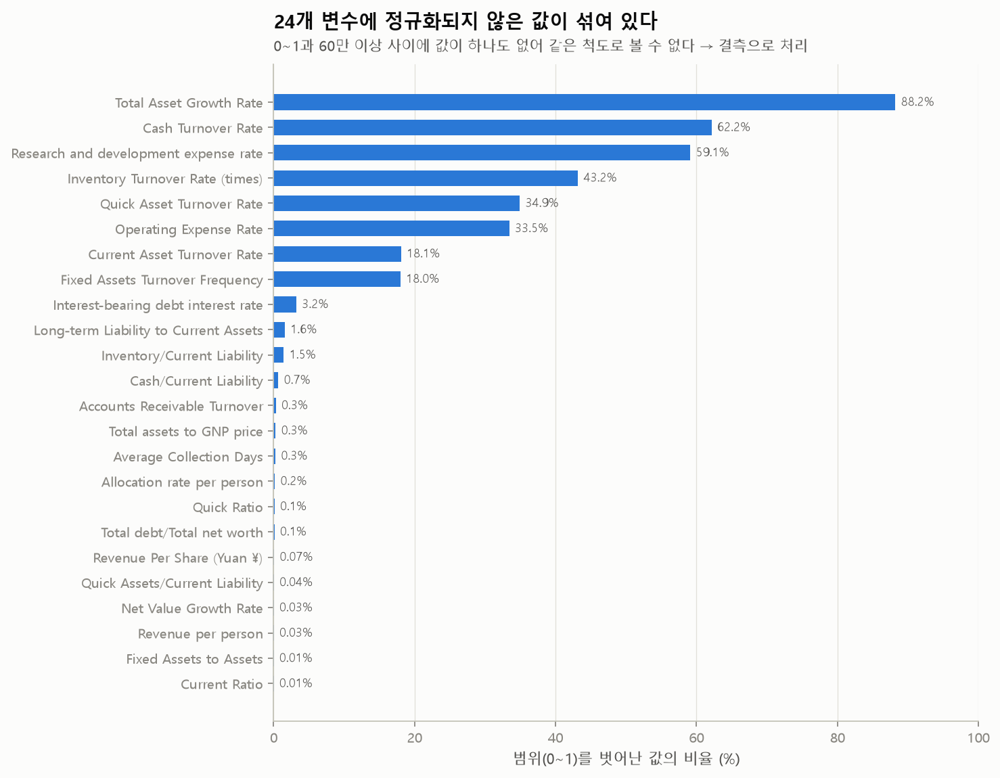
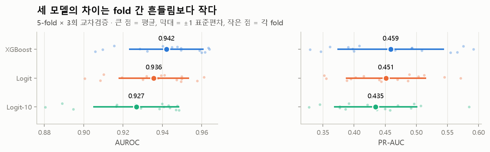
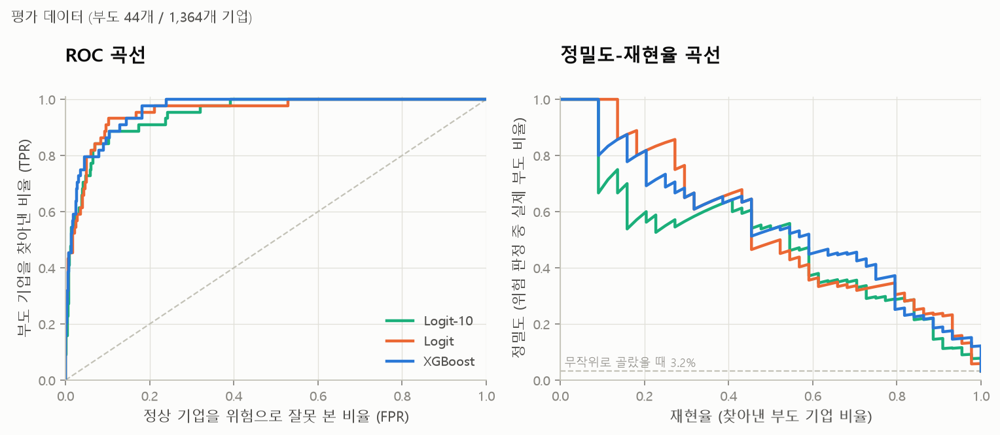
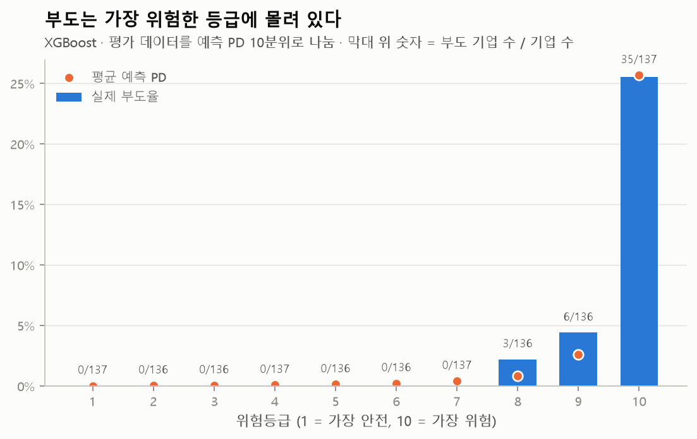
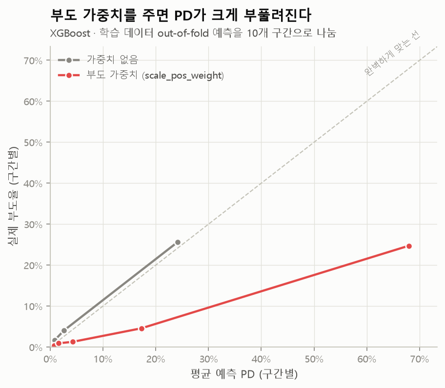
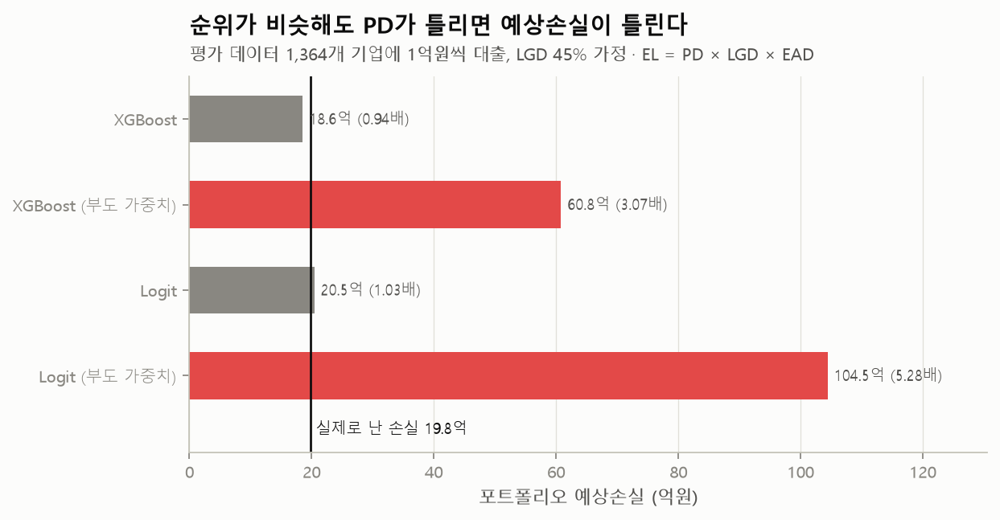
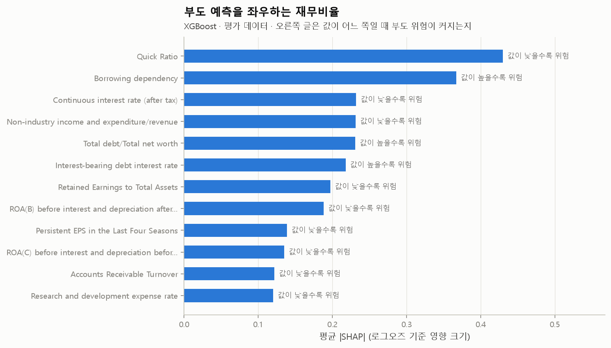
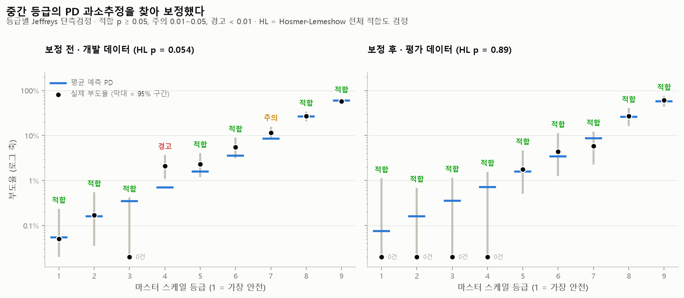
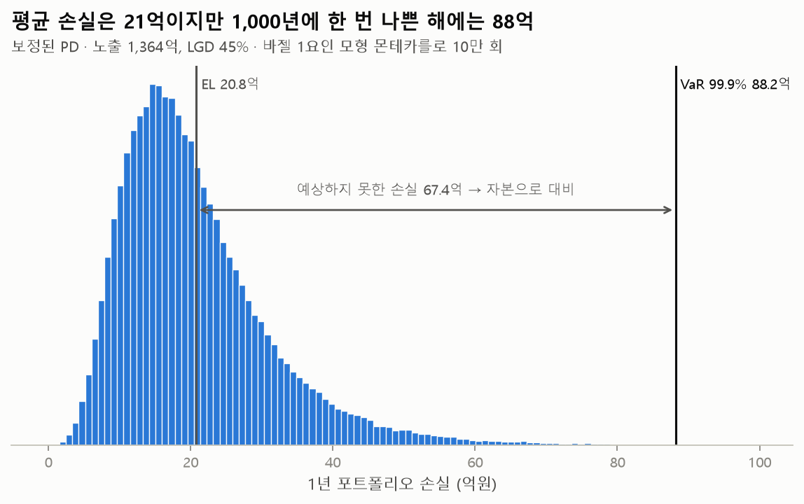
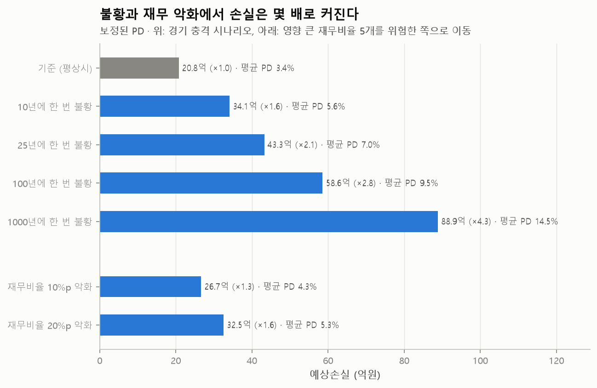

# 기업 부도 예측 (Corporate Default Prediction)

재무비율 95개로 기업의 부도확률(PD)을 예측하고, 그 PD를 **검증하고(모형 검증), 손실과 필요 자본으로 바꾸고(신용 VaR), 나쁜 상황을 가정해 보는(스트레스 테스트)** 데까지 이어간 신용리스크 관리 프로젝트입니다.
점수를 올리는 것보다 데이터가 믿을 만한지, 모델 간 차이가 진짜인지, 예측한 PD가 확률로서 맞는지를 확인하는 데 집중했습니다.

```
데이터 점검 → PD 모델 → 모형 검증·재보정 → 예상손실(EL) → 신용 VaR·필요 자본 → 스트레스 테스트
```

| 핵심 결과 | 내용 |
|---|---|
| 데이터 품질 | 0~1로 정규화됐다는 변수 24개에 정규화되지 않은 값 24,940개가 섞여 있음을 발견. 이 '흔적'만으로 부도를 AUROC 0.70으로 맞힐 수 있어서, 설명할 수 없는 신호로 보고 모델에서 제외 |
| 모델 비교 | XGBoost 0.942, 로지스틱 회귀 0.936, 변수 10개 로지스틱 회귀 0.927 (교차검증 AUROC). 차이가 fold 간 표준편차(약 0.02)보다 작고, 평가 데이터에서도 차이의 95% 신뢰구간이 0을 포함 |
| 위험등급 | 예측 PD 10등급 중 상위 2개 등급에 평가 데이터 부도 기업의 93%(44개 중 41개)가 모임. 등급이 나빠질수록 실제 부도율이 꾸준히 올라감 |
| PD 보정 | 불균형 데이터에서 흔히 쓰는 '부도 가중치'를 주면 AUROC는 비슷하지만 PD가 3~5배 부풀어, 예상손실이 실제 손실의 3.1~5.3배로 계산됨. 가중치 없는 모델은 0.94~1.03배 |
| 모형 검증 | 개발 데이터에서 4등급의 PD 과소추정을 발견(예측 0.71%, 실제 2.09%, '경고'). 파라미터 2개짜리 재보정 후 평가 데이터 9개 등급이 모두 '적합', Hosmer-Lemeshow p = 0.89 |
| 신용 VaR | 노출 1,364억 포트폴리오의 예상손실 20.8억, 99.9% VaR 88.2억, 필요 자본(UL) 67.4억. 바젤 IRB 공식(68.1억)과 몬테카를로 결과가 시드에 따라 −1.0% ~ +4.3% 범위에서 일치 |
| 스트레스 | 100년에 한 번 불황에서 예상손실 2.8배, 영향 큰 재무비율 5개가 20%p 나빠지면 1.6배 |

> 데이터: [UCI Taiwanese Bankruptcy Prediction](https://archive.ics.uci.edu/dataset/572/taiwanese+bankruptcy+prediction) (CC BY 4.0) · Python, scikit-learn, XGBoost, SHAP

---

## 1. 문제 정의

금융기관은 대출한 기업이 부도날 확률(PD)을 추정해 **위험등급을 매기고, 예상손실(EL)을 계산해 충당금과 자본을 준비**합니다.

```
EL = PD × LGD × EAD
     부도확률 × 부도 시 손실률 × 부도 시 노출금액
```

그래서 부도 예측 모델은 두 가지를 모두 맞혀야 합니다.

1. **순위**: 위험한 기업을 안전한 기업보다 위에 세우는가 (AUROC, AR, KS)
2. **확률**: 예측한 PD가 실제 부도율과 맞는가 (보정, Brier score)

일반적인 분류 문제처럼 순위만 보면 2번의 문제를 놓칩니다. 이 프로젝트는 두 가지를 모두 검증합니다.

## 2. 데이터

| 항목 | 내용 |
|---|---|
| 출처 | Taiwan Economic Journal, 1999~2009년 대만 상장기업 (UCI 저장소 공개) |
| 규모 | 기업 6,819개, 부도 220개 (부도율 3.23%) |
| 변수 | 수익성·안정성·성장성·활동성 재무비율 95개 |
| 부도 정의 | 대만 증권거래소 규정상 부도 판정 |
| 분할 | 학습 80% (5,455개, 부도 176개) / 평가 20% (1,364개, 부도 44개), 부도 비율 유지 |

### 데이터 점검에서 찾은 문제



데이터 설명과 달리 24개 변수에 0~1 범위를 벗어난 값이 있었습니다. 두 구간 사이(1 ~ 약 60만)에 값이 하나도 없어서, 조금 큰 이상치가 아니라 **정규화가 안 된 값이 그대로 섞인 것**으로 판단하고 결측 처리했습니다.

그런데 이 '범위 밖' 여부가 부도와 연관돼 있었습니다. 처리 방식별로 교차검증 AUROC를 비교했습니다.

| 처리 방식 | 로지스틱 회귀 | XGBoost |
|---|---|---|
| 원래 값 그대로 | 0.934 | 0.942 |
| **결측 처리 (채택)** | **0.936** | **0.942** |
| 결측 처리 + '범위 밖' 표시 변수 추가 | 0.934 | 0.942 |
| '범위 밖' 표시 변수만 사용 | 0.702 | 0.696 |

'범위 밖' 표시만으로 AUROC 0.70이 나옵니다. 재무 정보가 아니라 **데이터 처리 과정의 흔적이 부도를 예측**하는 셈입니다. 기존 변수에 더해도 성능은 오르지 않았고(XGBoost 0.942 그대로), 왜 맞히는지 설명할 수 없고 데이터 처리 방식이 바뀌면 무너질 신호라 쓰지 않았습니다.

그 밖에 값이 하나뿐인 변수 1개, 값이 같거나 1에서 뺀 관계인 변수 3개(예: 부채비율 ↔ 자기자본비율)를 지워 **91개 변수**로 분석했습니다.

## 3. 모델

| 모델 | 설명 | 고른 이유 |
|---|---|---|
| **Logit-10** | L1으로 변수 10개를 고른 로지스틱 회귀 | 신용평가 스코어카드처럼 사람이 읽고 설명할 수 있는 모델 |
| **Logit** | 변수 전체, L2 정규화 로지스틱 회귀 | 비교 기준선 |
| **XGBoost** | 그래디언트 부스팅 트리 | 비선형 관계와 변수 간 상호작용 |

- 결측 대체, 분위수 변환, 변수 선택을 모두 파이프라인 안에 넣어 **교차검증 각 fold의 학습 데이터로만** 학습되게 했습니다. 밖에서 미리 하면 검증 데이터 정보가 새어 성능이 부풀려집니다.
- 정확도(accuracy)는 쓰지 않았습니다. 모두 '정상'이라고만 해도 97%가 나오기 때문입니다.

## 4. 결과

### 4-1. 교차검증: 세 모델의 차이는 작다



| 모델 | AUROC | AR | KS | PR-AUC | 상위 10% 재현율 |
|---|---|---|---|---|---|
| Logit-10 | 0.927 ± 0.023 | 0.854 ± 0.045 | 0.738 ± 0.059 | 0.435 ± 0.069 | 0.731 ± 0.079 |
| Logit | 0.936 ± 0.019 | 0.871 ± 0.037 | 0.774 ± 0.026 | 0.451 ± 0.067 | 0.744 ± 0.080 |
| XGBoost | 0.942 ± 0.020 | 0.884 ± 0.039 | 0.779 ± 0.051 | 0.459 ± 0.089 | 0.777 ± 0.075 |

학습 데이터 5-fold × 3회 반복, 평균 ± 표준편차. PR-AUC의 무작위 기준선은 부도율인 0.032입니다.

### 4-2. 평가 데이터: 부도 44개로는 우열을 가릴 수 없다

| 모델 | AUROC (95% CI) | AR | KS | PR-AUC | Brier |
|---|---|---|---|---|---|
| Logit-10 | 0.947 (0.919 ~ 0.971) | 0.894 | 0.782 | 0.492 | 0.0217 |
| Logit | 0.954 (0.925 ~ 0.977) | 0.909 | 0.830 | 0.551 | 0.0207 |
| XGBoost | 0.961 (0.942 ~ 0.978) | 0.923 | 0.795 | 0.554 | 0.0204 |

같은 평가 표본을 부트스트랩해 두 모델의 차이를 직접 비교했습니다.

- XGBoost − Logit-10: AUROC +0.014 (95% CI −0.004 ~ +0.038)
- XGBoost − Logit: AUROC +0.007 (95% CI −0.014 ~ +0.036)

두 신뢰구간 모두 0을 포함합니다. XGBoost가 평균은 가장 높지만 통계적으로 의미 있는 차이라고 말할 수 없고, **변수 10개 모델도 실무 후보로 충분**합니다. 설명 가능성이 중요한 금융 실무라면 Logit-10을 기본 모델로, XGBoost를 비교용 도전 모델로 두는 구성도 합리적입니다.



### 4-3. 위험등급: 부도는 위험 등급에 몰려 있다



XGBoost의 예측 PD로 평가 데이터를 10등급으로 나눴습니다. 1~7등급(955개 기업)에서는 부도가 한 건도 없었고, **9·10등급에 부도 44개 중 41개(93%)**가 모였습니다. 등급이 나빠질수록 실제 부도율이 꾸준히 올라가고 내려가는 구간이 없습니다. 평균 예측 PD는 10등급에서 실제와 거의 같고(예측 25.7%, 실제 25.5%), 8·9등급에서는 실제보다 낮게 나옵니다(9등급 예측 2.6%, 실제 4.4%). 다만 8·9등급의 부도는 3건, 6건이라 표본이 작습니다.

### 4-4. PD 보정: '부도 가중치'의 함정

불균형 데이터에서는 소수 클래스에 가중치를 주라는 조언이 흔합니다. 직접 비교해 보니 순위 성능은 오르지 않았고, PD는 크게 부풀었습니다.



| 모델 (학습 데이터 out-of-fold) | AUROC | Brier | 평균 예측 PD | 실제 부도율 | 배율 |
|---|---|---|---|---|---|
| XGBoost | 0.943 | 0.0225 | 2.86% | 3.23% | 0.89 |
| XGBoost + 부도 가중치 | 0.936 | 0.0449 | 9.30% | 3.23% | 2.88 |
| Logit | 0.938 | 0.0233 | 3.27% | 3.23% | 1.01 |
| Logit + 부도 가중치 | 0.934 | 0.0846 | 16.83% | 3.23% | 5.22 |

이 차이가 예상손실에 그대로 이어집니다. 평가 데이터 1,364개 기업에 1억원씩 빌려주고 LGD를 45%(바젤 II 기초 내부등급법의 무담보 선순위 기준)로 가정한 가상 포트폴리오입니다.



가중치 없는 모델은 예상손실이 실제 손실(19.8억)과 거의 같지만(0.94~1.03배), 가중치를 준 모델은 3.1~5.3배로 과대추정합니다. **순위가 비슷해도 PD가 틀리면 손실 추정과 충당금이 틀립니다.**

### 4-5. 무엇이 부도를 예측하나



| 순위 | 변수 | 뜻 | 방향 |
|---|---|---|---|
| 1 | Quick Ratio | 당좌비율 (단기 지급 능력) | 낮을수록 위험 |
| 2 | Borrowing dependency | 차입 의존도 | 높을수록 위험 |
| 3 | Continuous interest rate (after tax) | 세후 이자율 지표 | 낮을수록 위험 |
| 4 | Non-industry income and expenditure/revenue | 영업외 손익 / 매출 | 낮을수록 위험 |
| 5 | Total debt/Total net worth | 부채 / 자기자본 | 높을수록 위험 |

XGBoost(SHAP)와 Logit-10은 따로 학습했는데도 **상위 변수 중 5개가 겹칩니다** (차입 의존도, 이익잉여금/총자산, ROA, 이자부채 이자율, 세후 이자율). 방향도 "빚이 많고 수익성이 낮을수록 위험"이라는 재무적 상식과 맞습니다.

### 4-6. 놓친 부도 기업

상위 10%를 위험으로 판정하면 평가 데이터 부도 44개 중 35개를 잡고 9개를 놓칩니다. 놓친 기업은 빚 지표의 중앙값이 잡아낸 부도 기업보다 **정상 기업에 가까웠습니다** (차입 의존도: 잡아낸 부도 0.383, 놓친 부도 0.377, 정상 0.373). 재무제표의 빚 지표만으로는 드러나지 않는 부도가 있다는 뜻으로, 주가 기반 부도확률(EDF)이나 뉴스 같은 다른 정보가 필요한 지점입니다.

## 5. 리스크 관리로 확장: 검증 → 손실 → 자본 → 스트레스

모델이 낸 PD를 금융기관이 실제로 쓰려면 세 가지가 더 필요합니다. PD를 믿어도 되는지 증명하고, PD를 손실과 자본으로 바꾸고, 나쁜 상황에서 얼마나 커지는지 봐야 합니다. 여기부터는 XGBoost의 PD를 씁니다.

### 5-1. 모형 검증: 중간 등급의 PD 과소추정을 찾아 보정했다

실제 등급 체계처럼 **예측 PD 구간으로 고정한 9개 등급(마스터 스케일)**을 만들고, 등급마다 "예측 PD가 맞다면 이만큼 부도가 날 수 있는가"를 검정했습니다. 표본이 작은 등급에도 쓸 수 있는 Jeffreys 단측검정을 썼고, p값으로 적합(≥ 0.05) · 주의(0.01~0.05) · 경고(< 0.01)를 매겼습니다.



| 검증 대상 | Hosmer-Lemeshow p | 등급 판정 |
|---|---|---|
| 개발 데이터 (out-of-fold), 보정 전 | 0.054 | 적합 7 · 주의 1 · 경고 1 |
| 평가 데이터, 보정 전 | 0.641 | 적합 9 |
| **평가 데이터, 보정 후** | **0.886** | **적합 9** |

1. **발견**: 개발 데이터에서 4등급(PD 0.5~1%)이 '경고'였습니다. 예측 0.71%인데 실제 부도율은 2.09%로, 예측대로라면 이만큼 부도가 날 확률이 0.1%에 불과합니다. 7등급도 '주의'(예측 8.5%, 실제 11.6%)였고, 전체 적합도 검정은 p = 0.054로 기준(0.05)의 경계였습니다.
2. **보정**: 예측 PD의 로짓에 로지스틱 회귀를 한 번 더 적합했습니다(Platt 보정, 기울기 0.898, 절편 −0.011). 개발 데이터의 out-of-fold 예측으로만 적합해 평가 데이터 정보는 쓰지 않았고, 단조 변환이라 순위(AUROC 0.961)는 그대로입니다.
3. **재검증**: 독립된 평가 데이터에서 9개 등급이 모두 적합이고 전체 적합도도 좋아졌습니다(p 0.641 → 0.886). 다만 평가 데이터는 보정 전에도 모두 적합이었고 부도가 44개뿐이라, 보정의 효과를 평가 데이터로 강하게 주장할 수는 없습니다. 보정은 개발 데이터에서 찾은 문제에 대한 대응이고, 보정 후 예상손실(20.8억)이 실제 손실(19.8억)보다 약간 큰 보수적인 쪽입니다.
4. **안정성**: 개발 데이터와 평가 데이터의 등급 분포 차이(PSI)는 0.006으로 기준(0.1)보다 훨씬 낮습니다. 무작위로 나눈 데이터라 당연한 결과이고, 실무에서는 분기마다 계산해 점수 분포가 변하는지 감시합니다.

### 5-2. 신용 VaR: 평균 손실과 나쁜 해의 손실은 다르다

예상손실(EL)은 평균일 뿐입니다. 기업들은 경기라는 공통 요인 때문에 함께 부도나므로, 나쁜 해에는 EL보다 훨씬 많이 잃습니다. 바젤 내부등급법의 바탕인 **1요인 모형**으로 경기 충격과 기업 고유 충격을 10만 번 뽑아 1년 손실 분포를 만들었습니다(평가 데이터 1,364개 기업, 기업당 1억원, LGD 45%, 바젤 기업 자산상관계수, PD 하한 0.03%).



| 항목 | 억원 | 노출 대비 | 의미 |
|---|---|---|---|
| EL | 20.8 | 1.5% | 평균 손실 → 충당금으로 대비 |
| VaR 99% | 58.9 | 4.3% | 100년에 한 번 수준의 손실 |
| VaR 99.9% | 88.2 | 6.5% | 1,000년에 한 번 수준의 손실 |
| ES 99.9% | 105.3 | 7.7% | VaR를 넘는 최악 0.1% 경우의 평균 |
| **UL = VaR 99.9% − EL** | **67.4** | **4.9%** | 예상하지 못한 손실 → 자본으로 대비 |
| 바젤 IRB 공식 UL | 68.1 | 5.0% | 같은 모형의 해석해 (교차검증용) |

**두 방법으로 계산해 맞췄습니다.** 몬테카를로 UL은 IRB 공식 대비 −1.0%였고, 시드를 바꾼 5번은 68.3~71.0억(+0.3% ~ +4.3%)이었습니다. 99.9% 분위수는 10만 번 중 가장 나쁜 100번으로 정해져 이 정도 흔들림이 있습니다. IRB 공식은 기업이 무한히 잘게 나뉜 포트폴리오를 가정하므로 기업 수가 유한하면 몬테카를로 쪽이 조금 커야 하는데, 시드 6개 중 5개가 그랬고 나머지 하나(−1.0%)는 시뮬레이션 오차 범위입니다.

### 5-3. 스트레스 테스트: 불황과 재무 악화에서 손실은 몇 배가 되나



| 시나리오 | 평균 PD | 예상손실 (억) | 기준 대비 |
|---|---|---|---|
| 기준 (평상시) | 3.39% | 20.8 | 1.00 |
| 10년에 한 번 불황 | 5.56% | 34.1 | 1.64 |
| 25년에 한 번 불황 | 7.05% | 43.3 | 2.08 |
| 100년에 한 번 불황 | 9.54% | 58.6 | 2.82 |
| 1,000년에 한 번 불황 | 14.48% | 88.9 | 4.27 |
| 재무비율 10%p 악화 | 4.35% | 26.7 | 1.28 |
| 재무비율 20%p 악화 | 5.30% | 32.5 | 1.56 |

- **경기 충격 시나리오**: 1요인 모형의 경기 충격을 'n년에 한 번' 수준으로 고정하고 조건부 PD를 계산했습니다. 1,000년에 한 번 시나리오의 손실(88.9억)이 99.9% VaR(88.2억)와 같은 수준인 것은 같은 모형에서 나왔기 때문입니다.
- **재무비율 악화 시나리오**: 부도 예측에 영향이 가장 큰 재무비율 5개(당좌비율, 차입 의존도, 세후 이자율 지표, 영업외 손익/매출, 부채/자기자본)를 학습 데이터 분포 기준으로 10%p, 20%p 위험한 쪽으로 옮겨 모델에 다시 넣었습니다. 옮기는 크기는 가정값입니다. 20%p 악화 때 8·9등급 비중이 5.9%에서 10.6%로 늘고, 등급 분포 변화(PSI)가 0.117로 '관찰 필요' 기준(0.1)을 넘습니다.

## 6. 한계와 다음 단계

- **시점 검증을 하지 못했습니다.** 데이터에 연도 정보가 없어 무작위로 나눴습니다. 실무에서는 과거로 학습해 이후 기간으로 검증(out-of-time)해야 하고, 경기 상황이 바뀌면 성능이 떨어질 수 있습니다.
- **평가 데이터의 부도가 44개뿐**이라 평가 지표의 신뢰구간이 넓습니다. 그래서 모델 비교는 교차검증을 중심으로 판단했습니다.
- **2000년대 대만 상장기업 데이터**라 국내 기업이나 비상장기업에 그대로 적용할 수 없습니다.
- 예상손실과 VaR의 **LGD, EAD는 가정값**입니다. 실제로는 담보와 업종에 따라 다르게 추정해야 합니다.
- 신용 VaR는 바젤 공식을 단순화했습니다. **만기 조정을 생략**했고, 자산상관계수는 바젤 기업 공식을 그대로 썼으며, 업종별 집중 위험은 반영하지 않았습니다.
- 재보정은 이 데이터의 평균 부도율에 맞춘 것입니다. 실무에서는 경기 순환 전체의 **장기 평균 부도율**에 맞춰 보정합니다.
- 다음 단계: 주가 변동성 기반 부도확률(Merton 모형/EDF)을 변수로 추가해 재무비율만 쓴 모델과 비교, 업종을 요인으로 넣은 다요인 신용 VaR.

## 7. 실행 방법

Windows와 Linux에서 실행을 확인했습니다 (Python 3.10 이상 권장). XGBoost는 운영체제와 라이브러리 버전에 따라 결과가 소수점 셋째 자리 정도 달라질 수 있으며, 이 README의 숫자는 Windows에서 실행한 `reports/results.md` 기준입니다. 로지스틱 회귀 결과는 환경과 관계없이 같았습니다.

```bash
python -m venv .venv
.venv\Scripts\activate            # macOS/Linux: source .venv/bin/activate
pip install -r requirements.txt

python scripts/download_data.py   # data/raw/data.csv 내려받기
python run_pipeline.py            # 전체 분석 (약 2~3분) → reports/ 에 결과 저장
python -m pytest -q               # 단위 테스트
```

분석 과정을 따라가며 보려면 `notebooks/analysis.ipynb`를 여세요. 자동 다운로드가 안 되면 [UCI 페이지](https://archive.ics.uci.edu/dataset/572/taiwanese+bankruptcy+prediction)에서 받아 `data/raw/data.csv`에 넣으면 됩니다.

## 8. 폴더 구조

```
corporate-default-prediction/
├── run_pipeline.py            # 전체 분석 실행 → reports/ 생성
├── src/default_risk/
│   ├── config.py              # 경로, 시드, 분할 비율, LGD·EAD 가정
│   ├── data.py                # 불러오기, 범위 밖 값 처리, 중복 변수 제거
│   ├── models.py              # Logit-10, Logit, XGBoost 파이프라인
│   ├── evaluation.py          # 반복 교차검증, out-of-fold 예측, 보정
│   ├── metrics.py             # AUROC·AR·KS·PR-AUC, 부트스트랩 신뢰구간, 등급표
│   ├── portfolio.py           # 예상손실(EL) 계산
│   ├── validation.py          # 마스터 스케일, 이항·Jeffreys·HL 검정, PSI, Platt 재보정
│   ├── credit_var.py          # 바젤 1요인 모형 몬테카를로, VaR·ES·UL, IRB 공식
│   ├── stress.py              # 경기 충격·재무비율 악화 시나리오
│   └── plotting.py            # 결과 그림
├── notebooks/analysis.ipynb   # 데이터 점검, 튜닝, 결과 해석
├── reports/
│   ├── results.md             # 모든 결과 표 (자동 생성)
│   ├── metrics.json
│   └── figures/
├── scripts/download_data.py
└── tests/                     # 단위 테스트 16개 (지표, 정제, VaR, 검증)
```

## 9. 용어

| 용어 | 뜻 |
|---|---|
| PD | 부도확률. 일정 기간(보통 1년) 안에 부도날 확률 |
| LGD / EAD | 부도 시 손실률 / 부도 시 노출금액 |
| EL | 예상손실 = PD × LGD × EAD |
| AUROC | 부도 기업을 정상 기업보다 위험하게 평가할 확률. 0.5면 무작위 |
| AR (Gini) | 2 × AUROC − 1. 신용평가모형 검증에서 주로 쓰는 표기 |
| KS | 부도·정상 기업의 누적 점수 분포가 가장 크게 벌어지는 지점의 차이 |
| Brier score | 예측 확률과 실제 결과(0/1)의 평균 제곱오차. 낮을수록 확률이 정확 |
| 보정 (calibration) | 예측 PD가 실제 부도율과 맞는 정도 |
| 마스터 스케일 | PD 구간으로 정한 고정 등급 체계 |
| Jeffreys 검정 | 등급별 실제 부도 수가 예측 PD로 설명되는지 보는 검정. 작은 표본에 적합 |
| Hosmer-Lemeshow | 예측 PD 구간별 기대 부도 수와 실제 부도 수 차이로 전체 보정을 보는 검정 |
| PSI | 두 시점의 점수(등급) 분포 차이. 0.1 미만 안정, 0.25 이상 큰 변화 |
| VaR / ES | 정해진 신뢰수준(예: 99.9%)의 손실 / 그 손실을 넘는 경우의 평균 손실 |
| UL | 예상하지 못한 손실 = VaR − EL. 자본으로 대비하는 부분 |

## 데이터 출처

Liang, D., Lu, C.-C., Tsai, C.-F., & Shih, G.-A. (2016). Financial ratios and corporate governance indicators in bankruptcy prediction: A comprehensive study. *European Journal of Operational Research*, 252(2), 561–572.
데이터는 [UCI Machine Learning Repository](https://archive.ics.uci.edu/dataset/572/taiwanese+bankruptcy+prediction)에서 CC BY 4.0으로 공개돼 있습니다.
